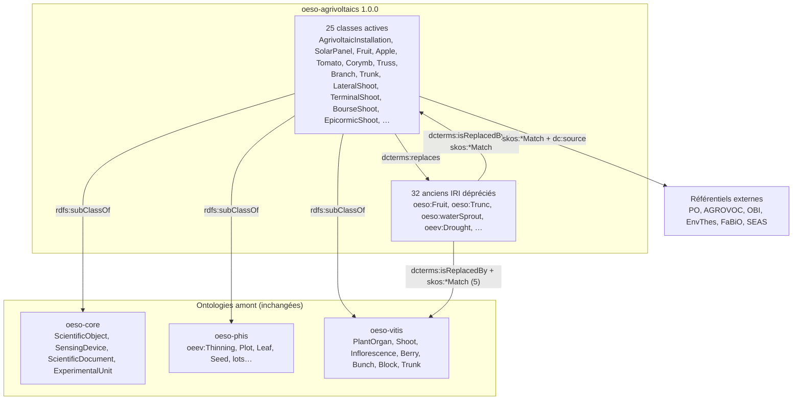

# oeso-agrivoltaics : alignement de oeso-sunagri sur oeso-vitis

Ontologie : `src/main/resources/ontologies/oeso-agrivoltaics.owl`, version 1.0.0 (2026-10-13).
Espace de noms : `http://www.opensilex.org/vocabulary/oeso-agrivoltaics#` (préfixe `oeso-agrivoltaics`).

## 1. Répartition des termes de oeso-sunagri

oeso-sunagri déclarait 186 IRI, toutes dans l'espace de noms `oeso:` d'oeso-core, aucune dans `oeso-sunagri#`.

| Où le terme est déjà défini | Nombre | Traitement |
|---|---|---|
| oeso-core | 43 | réutilisé tel quel, plus redéclaré |
| oeso-phis (chargé avec le module) | 100 | réutilisé tel quel, plus redéclaré |
| oeso-vitis (même IRI) | 13 | laissé dans oeso-vitis |
| nulle part ailleurs | 30 | déprécié ; 5 remplacés par un concept de oeso-vitis, 25 par un concept de oeso-agrivoltaics |

oeev-sunagri contenait 2 classes (`oeev:ManualThinning`, `oeev:Drought`), reprises de la même façon.
oeso-agrivoltaics contient donc 25 classes actives et 32 anciens IRI dépréciés.

## 2. Schéma de lien



Sur chaque ancien IRI : `owl:deprecated true`, label « obsolète … » / « obsolete … », `dcterms:isReplacedBy`
(un seul remplaçant, utilisé par la migration), le prédicat SKOS qui qualifie la correspondance,
`rdfs:isDefinedBy` vers l'ancienne ontologie et une `skos:historyNote` datée. Les anciens IRI n'ont aucun
axiome logique (OBO FP-019) : ils sortent de l'arbre des types d'OpenSILEX, et les données sont migrées.
Le schéma générique est décrit dans `.claude/skills/opensilex-ontology/references/link-scheme.md`.

## 3. Table de correspondance

| Ancien concept | Lien SKOS | Remplacé par | Remarque |
|---|---|---|---|
| `oeso:Apple` | `skos:exactMatch` | `oeso-agrivoltaics:Apple` |  |
| `oeso:Berry` | `skos:exactMatch` | `oeso-vitis:Berry` |  |
| `oeso:Block` | `skos:closeMatch` | `oeso-vitis:Block` | Définitions différentes : « groupe de plantes qui partagent les mêmes traitements » (oeso-sunagri) et « représentation structurelle de modalités de facteurs » (oeso-vitis). |
| `oeso:Branch` | `skos:exactMatch` | `oeso-agrivoltaics:Branch` |  |
| `oeso:Bunch` | `skos:closeMatch` | `oeso-vitis:Bunch` | oeso-sunagri rangeait la grappe sous Inflorescence ; oeso-vitis la définit comme une infructescence. |
| `oeso:Corymbe` | `skos:exactMatch` | `oeso-agrivoltaics:Corymb` |  |
| `oeso:Dendrometer` | `skos:closeMatch` | `oeso-agrivoltaics:Dendrometer` | L'ancien commentaire parlait de la hauteur du tronc ; la définition sourcée porte sur les variations de diamètre. |
| `oeso:EuropeanInfrastructure` | `skos:closeMatch` | `oeso-agrivoltaics:EuropeanInfrastructure` |  |
| `oeso:ExperimentalDesign` | `skos:exactMatch` | `oeso-agrivoltaics:ExperimentalDesign` |  |
| `oeso:ExperimentalSite` | `skos:exactMatch` | `oeso-agrivoltaics:ExperimentalSite` |  |
| `oeso:Fruit` | `skos:exactMatch` | `oeso-agrivoltaics:Fruit` |  |
| `oeso:Inflorescence` | `skos:exactMatch` | `oeso-vitis:Inflorescence` |  |
| `oeso:LateralShoot` | `skos:exactMatch` | `oeso-agrivoltaics:LateralShoot` |  |
| `oeso:LocalInfrastructure` | `skos:exactMatch` | `oeso-agrivoltaics:LocalInfrastructure` |  |
| `oeso:MasterThesis` | `skos:closeMatch` | `oeso-agrivoltaics:MasterThesis` |  |
| `oeso:NationalInfrastructure` | `skos:exactMatch` | `oeso-agrivoltaics:NationalInfrastructure` |  |
| `oeso:Panel` | `skos:narrowMatch` | `oeso-agrivoltaics:SolarPanel` | Remplacé par un concept plus spécifique : vérifier avant migration qu'aucune instance de oeso:Panel n'est autre chose qu'un panneau solaire. |
| `oeso:PhDThesis` | `skos:exactMatch` | `oeso-agrivoltaics:PhDThesis` |  |
| `oeso:Platform` | `skos:exactMatch` | `oeso-agrivoltaics:Platform` |  |
| `oeso:ShadeHouse` | `skos:closeMatch` | `oeso-agrivoltaics:AgrivoltaicInstallation` | Ancien concept sans définition, homonyme de oeso:Shadows (« ombrière », actionneur) : correspondance à valider par l'expert. |
| `oeso:Shoot` | `skos:exactMatch` | `oeso-vitis:Shoot` |  |
| `oeso:SolarPanel` | `skos:exactMatch` | `oeso-agrivoltaics:SolarPanel` |  |
| `oeso:Sucker` | `skos:closeMatch` | `oeso-agrivoltaics:EpicormicShoot` | En anglais, « sucker » désigne aussi le drageon issu des racines (AGROVOC c_24411). |
| `oeso:Terminal` | `skos:exactMatch` | `oeso-agrivoltaics:Terminal` |  |
| `oeso:TerminalShoot` | `skos:exactMatch` | `oeso-agrivoltaics:TerminalShoot` |  |
| `oeso:Tomato` | `skos:exactMatch` | `oeso-agrivoltaics:Tomato` |  |
| `oeso:Trunc` | `skos:exactMatch` | `oeso-agrivoltaics:Trunk` | Nom local mal orthographié (Trunc). |
| `oeso:Truss` | `skos:exactMatch` | `oeso-agrivoltaics:Truss` |  |
| `oeso:bourseShoot` | `skos:exactMatch` | `oeso-agrivoltaics:BourseShoot` |  |
| `oeso:waterSprout` | `skos:exactMatch` | `oeso-agrivoltaics:EpicormicShoot` |  |
| `oeev:ManualThinning` | `skos:exactMatch` | `oeso-agrivoltaics:ManualThinning` |  |
| `oeev:Drought` | `skos:exactMatch` | `oeso-agrivoltaics:Drought` |  |

### Sources des nouvelles définitions (vérifiées en ligne le 2026-10-13)

| Concept | Source principale |
|---|---|
| AgrivoltaicInstallation | Code de l'énergie art. L314-36 (loi n° 2023-175, art. 54) ; décret n° 2024-318 ; DIN SPEC 91434:2021-05 ; Dupraz et al. 2011 (doi:10.1016/j.renene.2011.03.005) ; AGROVOC c_9e7141ec (`skos:relatedMatch`) |
| Fruit, Corymb, Branch, LateralShoot, EpicormicShoot | Plant Ontology : PO:0009001, PO:0030124, PO:0025073, PO:0006343, PO:0004546 |
| Apple, Tomato | AGROVOC c_541 et c_7805 ; PO:0030110 (pome fruit), PO:0030108 (berry fruit) |
| Trunk | PO:0009047 stem (« trunk » en synonyme restreint) ; AGROVOC c_15017 |
| Truss | Silva Ferreira et al. 2018, J. Exp. Bot. (doi:10.1093/jxb/ery076) |
| BourseShoot | Wang et al. 2020, Front. Plant Sci. (doi:10.3389/fpls.2020.571918) ; Pratt 1988 (doi:10.1002/9781118060834.ch8) |
| Dendrometer | EnvThes 20365 ; Drew & Downes 2009 (doi:10.1016/j.dendro.2009.06.008) |
| ExperimentalDesign | OBI:0500000 study design |
| MasterThesis, PhDThesis | FaBiO (fabio:MastersThesis, fabio:DoctoralThesis) |
| ManualThinning | AGROVOC c_32701 ; Costa et al. 2018 (doi:10.1002/9781119521082.ch4) |
| Drought | Glossaire IPCC AR6 WGI, annexe VII (doi:10.1017/9781009157896.022) ; AGROVOC c_2391 |
| SolarPanel, TerminalShoot, Terminal, LocalInfrastructure, NationalInfrastructure, EuropeanInfrastructure, Platform, ExperimentalSite | **non sourcé** (mention dans `rdfs:comment`) |

## 4. Incohérences détectées

Rapport reproductible avec le skill `opensilex-ontology` (identifiants de règle entre crochets).

### oeso-sunagri.owl (remplacé)

- [N1, OOPS! P40] Les 30 concepts propres sont créés dans l'espace de noms `oeso:` d'oeso-core, qui ne les définit pas.
- [N1] 156 termes déjà définis dans core, phis ou vitis sont redéclarés, dont 144 avec leurs propres labels ou axiomes.
- [N2] Axiomes ajoutés à des termes d'autres ontologies. Le plus grave : `oeso:ScientificObject ⊑ hasGermplasm some Germplasm`,
  qui impose un matériel génétique à **tout** objet scientifique de la plateforme (panneaux et installations compris).
  Autres exemples : `oeso:Tree ⊑ oeso:ScientificObject` alors que vitis pose `oeso:Tree ⊑ oeso:Plant`, et `oeso:Shed ⊑ oeso:Facility`.
- [P1] 5 propriétés sont à la fois propriété d'objet et de données (`dateOfLastCalibration`, `dateOfPurchase`, `hasBrand`,
  `hasDate`, `inServiceDate`), ce qui est interdit en OWL 2 DL.
- [S2] 24 correspondances sont écrites comme texte dans `dc:source` (« skos:closeMatch … »).
- [L2] `oeso:ShadeHouse` et `oeso:Shadows` ont le même label « ombrière ». 7 classes ont le même label que leur équivalent dans vitis.
- Contenu : la définition et la correspondance de `oeso:Leaf` renvoient à PO:0000036, qui est « leaf vascular system » et
  non « leaf » (PO:0025034). Le label fr de `ExperimentalDesign` est « plant d'expérience » au lieu de « plan d'expérience ».
  Le commentaire de `Dendrometer` est en anglais sous l'étiquette @fr. Celui de `EuropeanInfrastructure` décrit le projet EMPHASIS
  au lieu de définir le concept. `Platform` n'a pas de super-classe et reste donc invisible. Enfin, `Trunc` est mal orthographié.
- [X1, H1] `xml:base` et l'espace de noms par défaut valent `oeev` (copier-coller). Il n'y a ni `owl:versionIRI` ni `dcterms:license`.
- Seuls 8 des 30 concepts propres avaient une définition, et 2 seulement une référence (sous forme de texte ou de `rdfs:seeAlso`).

### oeev-sunagri.owl (remplacé)

- [N1] 2 classes sont créées dans l'espace de noms `oeev:`. `ManualThinning` dépend de `oeev:Thinning`, défini dans **oeso-phis** et non dans oeso-core.
- Le `rdfs:label` de l'ontologie est identique à celui d'OEEv (« OpenSILEX - Ontology of Experimental Events (OEEv) »).
  Le `dc:creator` est altéré (« Noe SalvaNoé Savalle-Gloire »). Le commentaire de `Drought` reprend mot pour mot la note AGROVOC c_2391, sans la citer.

### oeso-vitis.owl (laissé tel quel ; à signaler à ses mainteneurs)

- [P1] 33 propriétés sont à la fois propriété d'objet et de données.
- [N1] 21 termes sont créés dans l'espace de noms `oeso:` sans y être définis : `CultivatedLand`, `Nursery`, `Phytotron`,
  `ProtectiveStructure`, `ResearchInfrastructure`, `Root`, `Row`, `InterRow`, `Tree`, `FinancialFunding`, les individus
  de financement et d'entités d'intérêt, `hasDate`, `hasDocument`… Les deux termes TransformON (moût, vin) sont importés
  sans `rdfs:isDefinedBy`.
- [R2] Les restrictions de `vitis:Vinestock` sur `hasGermplasm`, `hasGraft` et `hasRootstock` ont pour cible `vitis:Vinestock`
  lui-même ; on attendrait `oeso:Germplasm` ou `oeso:Variety`.
- [L1, L4, C1] `GroupOfGrapeVines` a 2 labels @en, dont l'un est une définition, et pas de définition @en.
  Sa source indique « A valider par Agnès Destrac ». `GroupsOfExperimentalPlot` a un label sans langue.
- [C1, C2] `Quadrat`, `Transect`, `hasGraft` et `hasRootstock` n'ont pas de définition. `Block`, `ExperimentalPlot`, `PlotComponent`
  et `Vinestock` ont une définition sans source. Pour `ExperimentalPlot`, la référence OEPP est dans `skos:note` et non dans `dc:source`.
- [NC1] `vitis:petiole` est en minuscule.
- `vitis:PlantOrgan` (défini par PO:0009008) regroupe des structures que ses propres définitions classent ailleurs dans PO :
  l'inflorescence est un système de pousse reproducteur (PO:0025082), le rameau une structure collective d'organes (PO:0025007).
- La source anglaise de « moût » cite `afeo#FinishedWine`. Celle de « vin » est en anglais mais contient du texte français.
- Il n'y a pas de `dcterms:license`. `xml:base` et l'espace de noms par défaut valent `http://purl.org/dc/elements/1.1/`.
  Le préfixe `oeso` y désigne `oeso-ext#`.

### Alignements à proposer aux ontologies propriétaires (non dépréciés ici, règle D7)

- `oeso:Leaf` (oeso-phis) et `oeso-vitis:Leaf` : même concept sous deux IRI.
- `oeso:Plot` (oeso-phis) et `oeso-vitis:ExperimentalPlot` : même label « plot » ; « placette » désigne `oeso:SubPlot` dans phis
  et `ExperimentalPlot` dans vitis.
- Le sens propre au Plot de sunagri (« gestion de l'ombrage ») relève d'un facteur expérimental, pas d'une classe.

### Module inrae-cropslife

- [G2] `CropsLifeModule` charge `ontologies/oeso-agrivoltaic.owl`, qui n'existe pas. Le fichier livré s'appelle `oeso-agrivoltaics.owl`.
- [G1] `oeso-agrivoltaic.owl` et `oeso-vitis.owl` sont déclarés dans le **même** graphe `oeso-sunagri#`. Avec reset, le second efface le premier.
- [G3] Le préfixe `oeso-vitis` désigne deux URI : `oeso-sunagri#` ici et `https://sixtine.inrae.fr/ontology#` dans inrae-sixtine-vigne.
- `sunagri-species.ttl` (non chargé) : la tomate (AGROVOC c_7805, qui désigne le fruit) porte le label latin « Vitis vinifera »@la.
  L'espèce correspond à c_4475 *Solanum lycopersicum*.

## 5. Points à valider par l'expert

1. `oeso:ShadeHouse` → `AgrivoltaicInstallation` (closeMatch).
2. `oeso:Panel` → `SolarPanel` (narrowMatch) : compter les instances de `oeso:Panel` avant la migration.
3. Fusion de `oeso:waterSprout` et `oeso:Sucker` en `EpicormicShoot` (gourmand).
4. `oeso:Terminal` : sens inconnu, à définir ou à déprécier sans remplaçant (`oboInOwl:consider`).
5. `Bunch` et `Block` alignés sur vitis malgré des définitions différentes (closeMatch).
6. Concepts génériques à remonter dans oeso-core : `Dendrometer`, infrastructures, `Platform`, `ExperimentalSite`, types de documents.
7. Définitions marquées « non sourcé » (8 concepts, voir § 3).

## 6. Déploiement

Déclaration proposée dans `CropsLifeModule.getOntologiesFiles()` (un graphe par fichier, oeev-sunagri retiré) :

```java
list.add(new OntologyFileDefinition(
        "http://www.opensilex.org/vocabulary/oeso-agrivoltaics#",
        "ontologies/oeso-agrivoltaics.owl",
        Lang.RDFXML,
        "oeso-agrivoltaics"
));
list.add(new OntologyFileDefinition(
        "http://www.opensilex.org/vocabulary/oeso-vitis#",
        "ontologies/oeso-vitis.owl",
        Lang.RDFXML,
        "oeso-vitis"
));
```

Ordre des opérations : voir `.claude/skills/opensilex-ontology/references/opensilex-integration.md`. En résumé : sauvegarde,
comptage, `opensilex system setup`, `DROP GRAPH <http://www.opensilex.org/vocabulary/oeso-sunagri#>` et
`DROP GRAPH <http://www.opensilex.org/vocabulary/oeev-sunagri#>`, migration SPARQL et MongoDB, recomptage.

```bash
python .claude/skills/opensilex-ontology/scripts/generate_migration.py inrae-cropslife/src/main/resources/ontologies/oeso-agrivoltaics.owl --sparql migration.rq --mongo migration.js
```

## 7. Reproduire les contrôles

```bash
CTX="opensilex-core/src/main/resources/ontologies/oeso-core.owl opensilex-phis/src/main/resources/ontologies/oeso-phis.owl inrae-cropslife/src/main/resources/ontologies/oeso-vitis.owl"
python .claude/skills/opensilex-ontology/scripts/check_ontology.py inrae-cropslife/src/main/resources/ontologies/oeso-agrivoltaics.owl --context $CTX
python .claude/skills/opensilex-ontology/scripts/check_module_graphs.py .
```

État au 2026-10-13 : oeso-agrivoltaics.owl, 0 erreur, 0 avertissement ; `check_module_graphs.py`, 2 erreurs (G1, G2) tant que
`CropsLifeModule` n'est pas corrigé.
