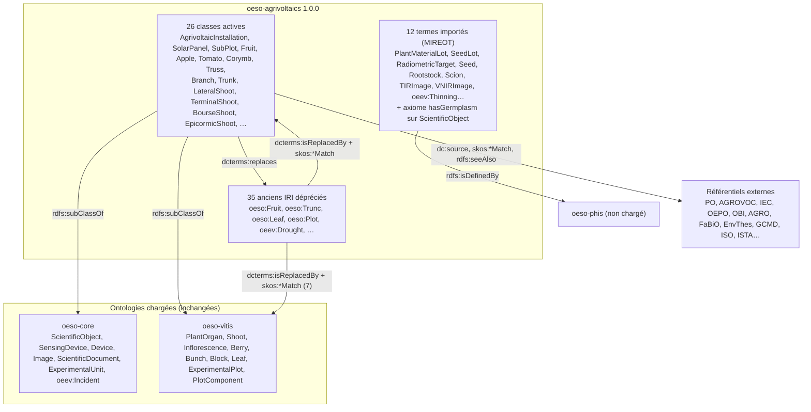

# oeso-agrivoltaics : alignement de oeso-sunagri sur oeso-vitis

Ontologie : `src/main/resources/ontologies/oeso-agrivoltaics.owl`, version 1.0.0 (2026-10-13).
Espace de noms : `http://www.opensilex.org/vocabulary/oeso-agrivoltaics#` (préfixe `oeso-agrivoltaics`).

**Contexte de chargement confirmé le 2026-10-13.** Ce sont les modules du `pom.xml` racine, sans `opensilex-phis`.
Les ontologies chargées sont donc `peco_factors.owl` et `oeso-core.owl` (opensilex-core), ainsi que
`oeso-agrivoltaics.owl` et `oeso-vitis.owl` (inrae-cropslife). oeso-phis **n'est pas chargé**.

```bash
python3 .claude/skills/opensilex-ontology/scripts/list_loaded_ontologies.py . --exclude opensilex-phis
```

## 1. Répartition des termes de oeso-sunagri

oeso-sunagri déclarait 186 IRI, toutes dans l'espace de noms `oeso:` d'oeso-core, aucune dans `oeso-sunagri#`.

| Où le terme est défini (contexte chargé) | Nombre | Traitement |
|---|---|---|
| oeso-core | 43 | réutilisé tel quel, plus redéclaré |
| oeso-vitis (même IRI) | 99 | laissé dans oeso-vitis |
| oeso-phis seulement (non chargé), et utilisé par le code ou les données | 11 | importé selon MIREOT : même IRI, `rdfs:isDefinedBy` vers oeso-phis |
| nulle part dans le contexte | 33 | déprécié : 7 remplacés par un concept de oeso-vitis, 26 par un concept de oeso-agrivoltaics |

Les 2 classes de oeev-sunagri (`oeev:ManualThinning`, `oeev:Drought`) sont dépréciées de la même façon.
`oeev:Thinning` (parent de l'éclaircissage manuel) et l'axiome `oeso:ScientificObject ⊑ hasGermplasm min 0 Germplasm`
sont importés d'oeso-phis. Sans cet axiome, les formulaires n'offrent plus le champ « matériel génétique ».

Au total, oeso-agrivoltaics contient 26 classes actives, 12 termes importés d'oeso-phis, 1 axiome importé et
35 anciens IRI dépréciés.

## 2. Schéma de lien



Chaque ancien IRI porte :
- `owl:deprecated true` et un label « obsolète … » / « obsolete … » ;
- `dcterms:isReplacedBy`, avec un seul remplaçant, qui pilote la migration ;
- un prédicat SKOS qui qualifie la correspondance ;
- `rdfs:isDefinedBy`, vers l'ancienne ontologie ;
- une `skos:historyNote` datée.

Les anciens IRI ne portent aucun axiome logique (OBO FP-019) : ils sortent de l'arbre des types d'OpenSILEX, et les
données sont migrées. Le schéma générique est décrit dans `.claude/skills/opensilex-ontology/references/link-scheme.md`.

## 3. Table de correspondance

| Ancien concept | Lien SKOS | Remplacé par | Remarque |
|---|---|---|---|
| `oeso:Apple` | `skos:exactMatch` | `oeso-agrivoltaics:Apple` |  |
| `oeso:Berry` | `skos:exactMatch` | `oeso-vitis:Berry` |  |
| `oeso:Block` | `skos:closeMatch` | `oeso-vitis:Block` | Définitions différentes : « groupe de plantes qui partagent les mêmes traitements » (oeso-sunagri) et « représentation structurelle de modalités de facteurs » (oeso-vitis). |
| `oeso:Branch` | `skos:exactMatch` | `oeso-agrivoltaics:Branch` |  |
| `oeso:Bunch` | `skos:closeMatch` | `oeso-vitis:Bunch` | oeso-sunagri rangeait la grappe sous Inflorescence ; oeso-vitis la définit comme une infructescence. |
| `oeso:Corymbe` | `skos:exactMatch` | `oeso-agrivoltaics:Corymb` |  |
| `oeso:Dendrometer` | `skos:closeMatch` | `oeso-agrivoltaics:Dendrometer` | L'ancien commentaire parlait de la hauteur du tronc ; la définition sourcée porte sur les variations de diamètre. |
| `oeso:EuropeanInfrastructure` | `skos:closeMatch` | `oeso-agrivoltaics:EuropeanInfrastructure` |  |
| `oeso:ExperimentalDesign` | `skos:exactMatch` | `oeso-agrivoltaics:ExperimentalDesign` |  |
| `oeso:ExperimentalSite` | `skos:exactMatch` | `oeso-agrivoltaics:ExperimentalSite` |  |
| `oeso:Fruit` | `skos:exactMatch` | `oeso-agrivoltaics:Fruit` |  |
| `oeso:Inflorescence` | `skos:exactMatch` | `oeso-vitis:Inflorescence` |  |
| `oeso:LateralShoot` | `skos:exactMatch` | `oeso-agrivoltaics:LateralShoot` |  |
| `oeso:LocalInfrastructure` | `skos:exactMatch` | `oeso-agrivoltaics:LocalInfrastructure` |  |
| `oeso:MasterThesis` | `skos:closeMatch` | `oeso-agrivoltaics:MasterThesis` |  |
| `oeso:NationalInfrastructure` | `skos:exactMatch` | `oeso-agrivoltaics:NationalInfrastructure` |  |
| `oeso:Panel` | `skos:narrowMatch` | `oeso-agrivoltaics:SolarPanel` | Vérifier avant migration qu'aucune instance de oeso:Panel n'est autre chose qu'un panneau solaire. |
| `oeso:PhDThesis` | `skos:exactMatch` | `oeso-agrivoltaics:PhDThesis` |  |
| `oeso:Platform` | `skos:exactMatch` | `oeso-agrivoltaics:Platform` |  |
| `oeso:ShadeHouse` | `skos:closeMatch` | `oeso-agrivoltaics:AgrivoltaicInstallation` | Ancien concept sans définition, homonyme de oeso:Shadows (« ombrière », actionneur) : à valider. |
| `oeso:Shoot` | `skos:exactMatch` | `oeso-vitis:Shoot` |  |
| `oeso:SolarPanel` | `skos:exactMatch` | `oeso-agrivoltaics:SolarPanel` |  |
| `oeso:Sucker` | `skos:closeMatch` | `oeso-agrivoltaics:EpicormicShoot` | En anglais, « sucker » désigne aussi le drageon issu des racines (AGROVOC c_24411). |
| `oeso:Terminal` | `skos:exactMatch` | `oeso-agrivoltaics:Terminal` |  |
| `oeso:TerminalShoot` | `skos:exactMatch` | `oeso-agrivoltaics:TerminalShoot` |  |
| `oeso:Tomato` | `skos:exactMatch` | `oeso-agrivoltaics:Tomato` |  |
| `oeso:Trunc` | `skos:exactMatch` | `oeso-agrivoltaics:Trunk` | Nom local mal orthographié (Trunc). |
| `oeso:Truss` | `skos:exactMatch` | `oeso-agrivoltaics:Truss` |  |
| `oeso:bourseShoot` | `skos:exactMatch` | `oeso-agrivoltaics:BourseShoot` |  |
| `oeso:waterSprout` | `skos:exactMatch` | `oeso-agrivoltaics:EpicormicShoot` |  |
| `oeso:Leaf` (oeso-phis) | `skos:exactMatch` | `oeso-vitis:Leaf` | oeso-phis et oeso-sunagri renvoyaient à PO:0000036 (leaf vascular system) ; oeso-vitis:Leaf correspond à PO:0025034 (leaf). |
| `oeso:Plot` (oeso-phis) | `skos:broadMatch` | `oeso-vitis:ExperimentalPlot` | Le sens propre à oeso-sunagri (« gestion de l'ombrage ») relève d'un facteur expérimental. |
| `oeso:SubPlot` (oeso-phis) | `skos:closeMatch` | `oeso-agrivoltaics:SubPlot` | oeso-phis le nomme « Placette », comme oeso-vitis:ExperimentalPlot. |
| `oeev:ManualThinning` | `skos:exactMatch` | `oeso-agrivoltaics:ManualThinning` |  |
| `oeev:Drought` | `skos:exactMatch` | `oeso-agrivoltaics:Drought` |  |

Si oeso-phis devait un jour être chargé avec ce module, la dépréciation de `oeso:Leaf`, `oeso:Plot` et `oeso:SubPlot`
entrerait en conflit avec lui (règle D7).

## 4. Définitions et sources (format oeso-vitis)

Les définitions sont en `rdfs:comment`, en @fr et en @en. Leur source suit la convention d'oeso-vitis en `dc:source` :
l'IRI du concept source, `Definition: <citation>`, `URI: <iri>` + `Definition: <citation>`, ou
`Definition adapted from: <sources>` pour une définition composée. Les références complémentaires sont en
`rdfs:seeAlso`. Une traduction est signalée dans le commentaire concerné. Toutes les sources ont été vérifiées en
ligne le 2026-10-13.

| Concept | Source de la définition |
|---|---|
| AgrivoltaicInstallation | Code de l'énergie art. L314-36 (loi n° 2023-175, art. 54) ; voir aussi décret n° 2024-318, DIN SPEC 91434:2021-05, Dupraz et al. 2011 |
| SolarPanel | IEC TS 61836:2025, 3.1.47 « photovoltaic panel » (IEC Glossary) |
| SubPlot | Nokoe S. 1992, AFNETA alley farming training manual (FAO) ; voir aussi STATO:0000444, AGRO:00000329, EPPO PP 1/152(4) |
| Fruit, Corymb, Branch | PO:0009001, PO:0030124, PO:0025073 (définitions recopiées) |
| Apple, Tomato | adaptées de PO:0030110 / PO:0030108 et AGROVOC c_4555 / c_4475 |
| Trunk | adaptée de PO:0009047 (« trunk », synonyme restreint) et AGROVOC c_15017 |
| LateralShoot | adaptée de PO:0006343 et du glossaire FAO de biotechnologie 2001 (« lateral bud » = « axillary bud ») |
| TerminalShoot | adaptée de PO:0004713 terminal bud |
| BourseShoot | Wang et al. 2020, Front. Plant Sci. (doi:10.3389/fpls.2020.571918) ; voir aussi Pratt 1988 |
| EpicormicShoot | adaptée de PO:0004546 epicormic shoot system |
| Dendrometer | EnvThes 20365 (Henderson's Dictionary of Biology) ; voir aussi Drew & Downes 2009 |
| LocalInfrastructure, NationalInfrastructure | OEPO, Tireau et al. 2018 (doi:10.15454/PG4VUH), définitions recopiées |
| EuropeanInfrastructure | adaptée de l'ESFRI Roadmap 2021, p. 12 ; voir aussi règlements (CE) 723/2009 et (UE) 2021/695 |
| Platform | Charte des plateformes IBiSA, « Définition » |
| ExperimentalSite | adaptée d'AGRO:00000360 experimental site |
| ExperimentalDesign | adaptée d'OBI:0500000 study design |
| MasterThesis, PhDThesis | FaBiO 2.3.1 (fabio:MastersThesis, fabio:DoctoralThesis), définitions recopiées |
| ManualThinning | adaptée du glossaire FAO de biotechnologie 2001 (« thinning », sens 2) et de Patiyal et al. 2024 |
| Drought | glossaire IPCC AR6 WGI, annexe VII (doi:10.1017/9781009157896.022) |
| **Terminal** | **non sourcé** : sens inconnu (absent de l'ontologie Sun'Agri d'origine) |
| oeev:Thinning (importé) | Costa et al. 2018 (doi:10.1002/9781119521082.ch4) |
| PlantMaterialLot, RootstockLot, ScionLot (importés) | adaptées de BrAPI v2.1 SeedLot/InventoryLot et d'AGROVOC c_6653 / c_6857 |
| SeedLot (importé) | ISTA Rules 2025, chap. 2, 2.2.1 (doi:10.15258/istarules.2025.02) |
| Vitroplant (importé) | adaptée d'AGROVOC c_27626 et du glossaire FAO (« plantlet ») |
| RadiometricTarget (importé) | adaptée d'Aasen et al. 2018, Remote Sensing 10(7):1091, § 4.3.2 |
| Seed (importé) | PO:0009010 |
| Rootstock, Scion (importés) | AGROVOC c_6653 (glossaire FAO 2001) et c_6857 (FAO 1993) ; elles remplacent les définitions d'oeso-phis, propres à la vigne |
| TIRImage, VNIRImage (importés) | adaptées de NASA GCMD « THERMAL INFRARED » et d'ISO 20473:2007 |

## 5. Contrôles

| Outil | Résultat sur oeso-agrivoltaics.owl |
|---|---|
| `check_ontology.py` (SHACL + Python), contexte confirmé, `--code-root .` | 0 erreur ; 1 avertissement D9 (`oeso:Plot` est cité comme exemple dans la documentation Swagger d'oeso-core) ; 1 info N3 (axiome importé) |
| `robot validate-profile --profile DL` | conforme OWL 2 DL |
| `robot reason` ELK et HermiT, fichier fusionné avec le contexte | cohérent, aucune classe insatisfiable |
| `robot report`, profil OpenSILEX | 0 ERROR, 0 WARN, 0 INFO |
| `check_module_graphs.py --exclude opensilex-phis` | aucune erreur (un graphe par fichier dans `CropsLifeModule`) |

## 6. Incohérences détectées dans les fichiers existants

### oeso-sunagri.owl (remplacé)

- [N1, OOPS! P40] Les 30 concepts propres sont créés dans l'espace de noms `oeso:` d'oeso-core, qui ne les définit pas.
- [N2] Axiomes ajoutés à des termes d'autres ontologies, dont `oeso:ScientificObject ⊑ hasGermplasm some Germplasm`,
  qui impose un matériel génétique à **tout** objet scientifique.
- [P1, confirmé par ROBOT] 5 propriétés sont à la fois propriété d'objet et de données : le fichier n'est pas OWL 2 DL.
- [S2] 24 correspondances sont écrites comme texte dans `dc:source`.
- [L2] `oeso:ShadeHouse` et `oeso:Shadows` ont le même label « ombrière ».
- La définition de `oeso:Leaf` renvoie à PO:0000036 (« leaf vascular system »). Le label fr de `ExperimentalDesign` est
  « plant d'expérience ». Le commentaire de `Dendrometer` est en anglais sous l'étiquette @fr.
  `EuropeanInfrastructure` décrit EMPHASIS au lieu de définir le concept. `Platform` n'a pas de super-classe.
  `Trunc` est mal orthographié.
- [X1, H1] `xml:base` et l'espace de noms par défaut valent `oeev`. Il n'y a ni `owl:versionIRI` ni `dcterms:license`.

### oeev-sunagri.owl (remplacé)

- [N1] 2 classes sont créées dans l'espace de noms `oeev:`. ROBOT signale deux classes non déclarées : `oeev:Thinning`
  (défini seulement dans oeso-phis) et `oeev:Incident`.
- Le label de l'ontologie est identique à celui d'OEEv, et le `dc:creator` est altéré.

### oeso-vitis.owl (laissé tel quel ; à signaler à ses mainteneurs)

- [P1, ROBOT] 33 propriétés sont à la fois propriété d'objet et de données : le fichier n'est pas OWL 2 DL
  (192 lignes de violations).
- [N1] 21 termes sont créés dans l'espace de noms `oeso:` sans y être définis. Les termes TransformON sont importés
  sans `rdfs:isDefinedBy`.
- [R2] Les restrictions de `Vinestock` ont pour cible `Vinestock` lui-même.
- [L1, L4, C1, C2] `GroupOfGrapeVines` a 2 labels @en, dont l'un est une définition. `Quadrat`, `Transect`,
  `hasGraft` et `hasRootstock` n'ont pas de définition.
- [NC1] `petiole` est en minuscule.
- [ROBOT] Labels en double (`Lens`/`hasLens`, `FinancialFunding`/`hasFinancialFunding`, etc.). `owl:deprecated` n'a pas
  le type booléen sur `hasAcronym`. Il manque `dcterms:title`, `dcterms:description` et `dcterms:license`.
- Sans oeso-phis, aucune classe de vitis ne propose `hasGermplasm` dans les formulaires (seul `Vinestock` a une
  restriction, erronée). L'axiome importé par oeso-agrivoltaics comble ce manque pour tous les objets scientifiques.

### oeso-phis.owl (non chargé ; constats utiles à son propriétaire)

- `oeso:Leaf` renvoie à PO:0000036 au lieu de PO:0025034.
- Le label fr de `PlantMaterialLot` est « Lot de matériel vegetal », sans accent.
- Les définitions de `Rootstock` et `Scion` ne concernent que la vigne.
- L'ontologie n'a pas de `owl:versionIRI`.

### Module inrae-cropslife

- `CropsLifeModule` déclare désormais `oeso-agrivoltaics.owl` et `oeso-vitis.owl` dans deux graphes distincts. Les
  erreurs G1 et G2 sont corrigées.
- `sunagri-species.ttl` (non chargé) : la tomate (AGROVOC c_7805) porte le label latin « Vitis vinifera »@la.

## 7. Points à valider par l'expert

1. `oeso:ShadeHouse` → `AgrivoltaicInstallation` (closeMatch, définition du Code de l'énergie).
2. `oeso:Panel` → `SolarPanel` (narrowMatch) : compter les instances avant la migration. L'IEC distingue le panneau
   (3.1.47) du module (3.1.44).
3. Fusion de `oeso:waterSprout` et `oeso:Sucker` en `EpicormicShoot` (gourmand).
4. `oeso:Terminal` : sens inconnu, seul concept non sourcé. Le définir, ou le déprécier sans remplaçant (`oboInOwl:consider`).
5. `ExperimentalSite` reste une organisation (`oeso:ExperimentalUnit`). AGRO le définit comme un lieu, ce que
   représente `org:Site` dans oeso-core.
6. `oeso:Leaf` → `oeso-vitis:Leaf` et `oeso:Plot` → `oeso-vitis:ExperimentalPlot` : ces dépréciations ne valent que tant
   qu'oeso-phis n'est pas chargé.
7. À remonter dans oeso-core : l'axiome `hasGermplasm` sur `ScientificObject`, `PlantMaterialLot` (constante Java),
   `Dendrometer`, les infrastructures, `Platform` et les types de documents.

## 8. Déploiement

1. Sauvegarder le triplestore et MongoDB.
2. Compter les instances des anciens types : requêtes `COUNT` en commentaire de la migration générée.
3. `opensilex system setup` charge les graphes déclarés par `CropsLifeModule`.
4. Supprimer les graphes qui ne sont plus déclarés : `DROP GRAPH <http://www.opensilex.org/vocabulary/oeso-sunagri#>`
   et `DROP GRAPH <http://www.opensilex.org/vocabulary/oeev-sunagri#>`.
5. Exécuter la migration : 35 requêtes SPARQL Update et 35 mises à jour de `geospatial.rdfType`.

   ```bash
   python .claude/skills/opensilex-ontology/scripts/generate_migration.py inrae-cropslife/src/main/resources/ontologies/oeso-agrivoltaics.owl --sparql migration.rq --mongo migration.js
   ```

6. Recompter, puis vérifier dans l'interface : arbre des types, et champ « matériel génétique » sur un objet scientifique.

## 9. Reproduire les contrôles

```bash
CTX=$(python3 .claude/skills/opensilex-ontology/scripts/list_loaded_ontologies.py . --exclude opensilex-phis --format args)
python .claude/skills/opensilex-ontology/scripts/check_ontology.py inrae-cropslife/src/main/resources/ontologies/oeso-agrivoltaics.owl --context $CTX --code-root .
python3 .claude/skills/opensilex-ontology/scripts/robot_checks.py inrae-cropslife/src/main/resources/ontologies/oeso-agrivoltaics.owl --context $CTX
python3 .claude/skills/opensilex-ontology/scripts/check_module_graphs.py . --exclude opensilex-phis
```
